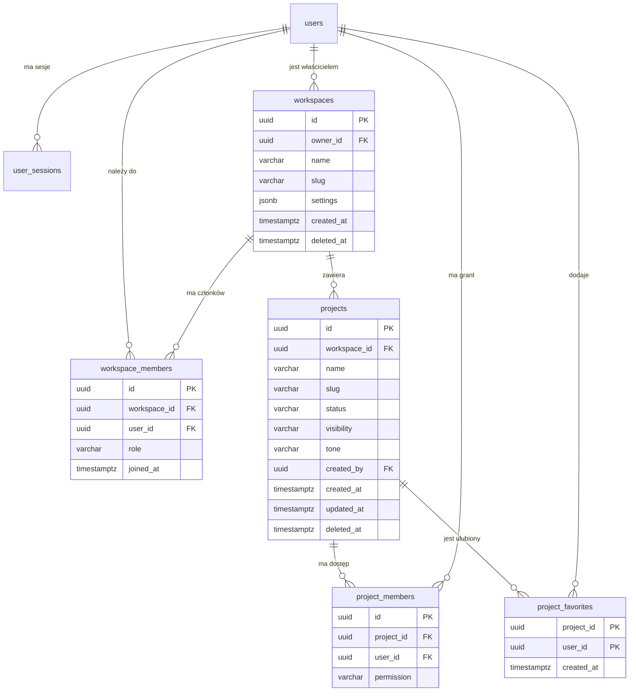
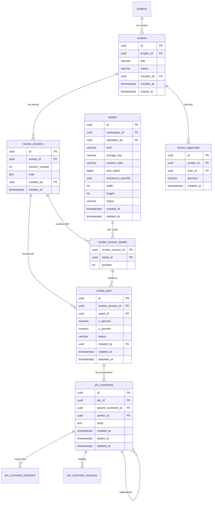
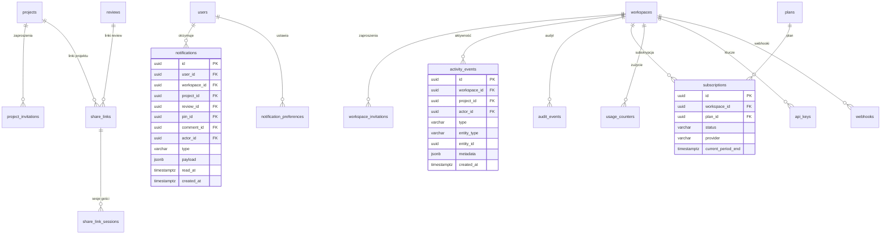

# MarkerIt — model bazy danych (propozycja)

> **Status: PROPOZYCJA DO AKCEPTACJI.** Ten dokument opisuje docelowy model danych.
> Nie zawiera jeszcze migracji ani kodu. Po akceptacji model zostanie wdrożony
> etapami jako migracje Flyway (`V4__...`, `V5__...`).

## 1. Założenia

- Baza: PostgreSQL 17, migracje Flyway, dostęp przez Spring Data JPA.
- Klucze główne: `UUID` (generowane w aplikacji).
- Czasy: `TIMESTAMPTZ`, domyślnie `CURRENT_TIMESTAMP`; `updated_at` aktualizowany triggerem.
- Nazewnictwo: `snake_case`, tabele w liczbie mnogiej.
- Zamiast natywnych enumów PostgreSQL używamy `VARCHAR` + `CHECK`, żeby dodawanie
  wartości nie wymagało migracji typu.
- Soft delete (`deleted_at`) dla encji biznesowych: użytkownik, workspace, projekt,
  review, asset, pin, komentarz. Twarde usuwanie tylko przez zadania retencji.
- Tokeny (zaproszenia, linki share, API keys) przechowywane wyłącznie jako hash.
- Liczniki (liczba uwag, projektów itd.) **nie są** duplikowane w kolumnach —
  liczymy je zapytaniem/widokiem, dopóki wydajność nie wymusi tabeli agregatów.
- Każdy projekt należy do workspace'u. Workspace jest granicą tenanta i uprawnień.
- `users` już istnieje; model go rozszerza, nie zastępuje.

## 2. Diagram relacji — rdzeń

## 3. Diagram relacji — review, pinezki i komentarze

## 4. Diagram relacji — współpraca, powiadomienia, operacje

## 5. Tabela po tabeli

### 5.1. Rozszerzenie istniejących tabel

#### `users` (istnieje — rozszerzenie)

| Kolumna | Typ | Ograniczenia | Uwagi |
| --- | --- | --- | --- |
| `display_name` | `VARCHAR(80)` |  | Nazwa wyświetlana; dziś wyliczana z e-maila |
| `avatar_url` | `TEXT` |  | Docelowo może wskazywać asset |
| `locale` | `VARCHAR(10)` | `NOT NULL DEFAULT 'pl'` | `pl` / `en` |
| `last_seen_at` | `TIMESTAMPTZ` |  | Ostatnia aktywność |
| `deleted_at` | `TIMESTAMPTZ` |  | Soft delete konta |

Bez zmian pozostają: `id`, `email`, `password_hash`, `email_verified`, `created_at`, `updated_at`.

#### `user_sessions`, `email_verification_codes`

Bez zmian. Indeksy już istnieją.

### 5.2. Etap 1 — workspace i projekty (potrzebne dla obecnego dashboardu)

#### `workspaces`

| Kolumna | Typ | Ograniczenia |
| --- | --- | --- |
| `id` | `UUID` | PK |
| `owner_id` | `UUID` | `NOT NULL REFERENCES users(id) ON DELETE RESTRICT` |
| `name` | `VARCHAR(80)` | `NOT NULL`, `CHECK (length(btrim(name)) > 0)` |
| `slug` | `VARCHAR(80)` | `NOT NULL` |
| `description` | `TEXT` |  |
| `avatar_url` | `TEXT` |  |
| `settings` | `JSONB` | `NOT NULL DEFAULT '{}'` |
| `created_at` | `TIMESTAMPTZ` | `NOT NULL DEFAULT now()` |
| `updated_at` | `TIMESTAMPTZ` | `NOT NULL DEFAULT now()` |
| `deleted_at` | `TIMESTAMPTZ` |  |

- Unikalny `LOWER(slug)` wśród nieusuniętych.
- Indeks `owner_id`.

#### `workspace_members`

| Kolumna | Typ | Ograniczenia |
| --- | --- | --- |
| `id` | `UUID` | PK |
| `workspace_id` | `UUID` | `NOT NULL REFERENCES workspaces(id) ON DELETE CASCADE` |
| `user_id` | `UUID` | `NOT NULL REFERENCES users(id) ON DELETE CASCADE` |
| `role` | `VARCHAR(20)` | `CHECK (role IN ('OWNER','ADMIN','MEMBER','VIEWER'))` |
| `invited_by` | `UUID` | `REFERENCES users(id) ON DELETE SET NULL` |
| `joined_at` | `TIMESTAMPTZ` | `NOT NULL DEFAULT now()` |
| `created_at` | `TIMESTAMPTZ` | `NOT NULL DEFAULT now()` |

- `UNIQUE (workspace_id, user_id)`.
- Częściowy unikat: jeden `OWNER` na workspace.
- Indeks `user_id` (lista workspace'ów użytkownika).

#### `projects`

| Kolumna | Typ | Ograniczenia |
| --- | --- | --- |
| `id` | `UUID` | PK |
| `workspace_id` | `UUID` | `NOT NULL REFERENCES workspaces(id) ON DELETE CASCADE` |
| `name` | `VARCHAR(50)` | `NOT NULL`, `CHECK (length(btrim(name)) >= 3)` |
| `slug` | `VARCHAR(60)` | `NOT NULL` |
| `description` | `TEXT` |  |
| `status` | `VARCHAR(20)` | `NOT NULL DEFAULT 'ACTIVE'`, `CHECK (status IN ('ACTIVE','IN_REVIEW','CLOSED','ARCHIVED'))` |
| `visibility` | `VARCHAR(20)` | `NOT NULL DEFAULT 'WORKSPACE'`, `CHECK (visibility IN ('WORKSPACE','PRIVATE'))` |
| `tone` | `VARCHAR(20)` | `NOT NULL DEFAULT 'sage'`, `CHECK (tone IN ('sage','sand','blue','lilac','emerald','amber'))` |
| `created_by` | `UUID` | `REFERENCES users(id) ON DELETE SET NULL` |
| `created_at` | `TIMESTAMPTZ` | `NOT NULL DEFAULT now()` |
| `updated_at` | `TIMESTAMPTZ` | `NOT NULL DEFAULT now()` |
| `archived_at` | `TIMESTAMPTZ` |  |
| `deleted_at` | `TIMESTAMPTZ` |  |

- `UNIQUE (workspace_id, slug)` wśród nieusuniętych.
- Indeksy: `(workspace_id, status)`, `(workspace_id, updated_at DESC)`.
- Mapowanie obecnego UI: `W toku` → `ACTIVE`, `Do sprawdzenia` → `IN_REVIEW`,
  `Zamknięty` → `CLOSED`, `Archiwum` → `ARCHIVED`.
- `isShared` nie jest kolumną — wynika z `project_members` / `share_links`.

#### `project_members`

| Kolumna | Typ | Ograniczenia |
| --- | --- | --- |
| `id` | `UUID` | PK |
| `project_id` | `UUID` | `NOT NULL REFERENCES projects(id) ON DELETE CASCADE` |
| `user_id` | `UUID` | `NOT NULL REFERENCES users(id) ON DELETE CASCADE` |
| `permission` | `VARCHAR(20)` | `CHECK (permission IN ('VIEW','COMMENT','EDIT','ADMIN'))` |
| `added_by` | `UUID` | `REFERENCES users(id) ON DELETE SET NULL` |
| `created_at` | `TIMESTAMPTZ` | `NOT NULL DEFAULT now()` |

- `UNIQUE (project_id, user_id)`, indeks `user_id`.
- Członkowie workspace'u widzą projekty `WORKSPACE`; `PRIVATE` tylko osoby z grantem.
- Zewnętrzni współpracownicy dostają grant tutaj, bez członkostwa w workspace.

#### `project_favorites` (etap 1, opcjonalne)

- `project_id`, `user_id`, `created_at`; PK `(project_id, user_id)`.

### 5.3. Etap 2 — pliki, review, pinezki, komentarze

#### `assets`

| Kolumna | Typ | Ograniczenia |
| --- | --- | --- |
| `id` | `UUID` | PK |
| `workspace_id` | `UUID` | `NOT NULL REFERENCES workspaces(id) ON DELETE CASCADE` |
| `uploaded_by` | `UUID` | `REFERENCES users(id) ON DELETE SET NULL` |
| `kind` | `VARCHAR(20)` | `CHECK (kind IN ('IMAGE','PDF','VIDEO','OTHER'))` |
| `storage_provider` | `VARCHAR(20)` | `NOT NULL DEFAULT 'local'`, `CHECK (storage_provider IN ('local','s3','r2'))` |
| `storage_key` | `TEXT` | `NOT NULL` |
| `original_name` | `TEXT` | `NOT NULL` |
| `content_type` | `VARCHAR(255)` | `NOT NULL` |
| `size_bytes` | `BIGINT` | `NOT NULL CHECK (size_bytes >= 0)` |
| `checksum_sha256` | `CHAR(64)` |  |
| `width` | `INTEGER` | `CHECK (width IS NULL OR width > 0)` |
| `height` | `INTEGER` | `CHECK (height IS NULL OR height > 0)` |
| `status` | `VARCHAR(20)` | `NOT NULL DEFAULT 'READY'`, `CHECK (status IN ('UPLOADING','READY','FAILED'))` |
| `metadata` | `JSONB` | `NOT NULL DEFAULT '{}'` |
| `created_at` | `TIMESTAMPTZ` | `NOT NULL DEFAULT now()` |
| `deleted_at` | `TIMESTAMPTZ` |  |

- `UNIQUE (storage_provider, storage_key)`.
- Indeks `(workspace_id, created_at DESC)`.

#### `asset_variants` (miniatury/preview — etap 2+)

- `id`, `asset_id`, `variant` (`thumb`, `preview`, `original`), `storage_key`,
  `width`, `height`, `size_bytes`, `created_at`.
- `UNIQUE (asset_id, variant)`.

#### `reviews`

Review = kontener na jedną rzecz do oceny (np. makieta, plakat, ekran) wraz z wersjami.

| Kolumna | Typ | Ograniczenia |
| --- | --- | --- |
| `id` | `UUID` | PK |
| `project_id` | `UUID` | `NOT NULL REFERENCES projects(id) ON DELETE CASCADE` |
| `title` | `VARCHAR(120)` | `NOT NULL` |
| `description` | `TEXT` |  |
| `status` | `VARCHAR(20)` | `NOT NULL DEFAULT 'OPEN'`, `CHECK (status IN ('OPEN','CLOSED'))` |
| `created_by` | `UUID` | `REFERENCES users(id) ON DELETE SET NULL` |
| `created_at` | `TIMESTAMPTZ` | `NOT NULL DEFAULT now()` |
| `updated_at` | `TIMESTAMPTZ` | `NOT NULL DEFAULT now()` |
| `closed_at` | `TIMESTAMPTZ` |  |
| `deleted_at` | `TIMESTAMPTZ` |  |

- Indeksy: `(project_id, status)`, `(project_id, updated_at DESC)`.

#### `review_versions`

| Kolumna | Typ | Ograniczenia |
| --- | --- | --- |
| `id` | `UUID` | PK |
| `review_id` | `UUID` | `NOT NULL REFERENCES reviews(id) ON DELETE CASCADE` |
| `version_number` | `INTEGER` | `NOT NULL CHECK (version_number > 0)` |
| `note` | `TEXT` |  |
| `created_by` | `UUID` | `REFERENCES users(id) ON DELETE SET NULL` |
| `created_at` | `TIMESTAMPTZ` | `NOT NULL DEFAULT now()` |

- `UNIQUE (review_id, version_number)`.

#### `review_version_assets`

| Kolumna | Typ | Ograniczenia |
| --- | --- | --- |
| `review_version_id` | `UUID` | `NOT NULL REFERENCES review_versions(id) ON DELETE CASCADE` |
| `asset_id` | `UUID` | `NOT NULL REFERENCES assets(id) ON DELETE RESTRICT` |
| `position` | `INTEGER` | `NOT NULL DEFAULT 0 CHECK (position >= 0)` |

- PK `(review_version_id, asset_id)`.
- `UNIQUE (review_version_id, position)`.
- Serwis waliduje, że `assets.workspace_id` = workspace projektu.

#### `review_pins`

| Kolumna | Typ | Ograniczenia |
| --- | --- | --- |
| `id` | `UUID` | PK |
| `review_version_id` | `UUID` | `NOT NULL` |
| `asset_id` | `UUID` | `NOT NULL` |
| `x_percent` | `NUMERIC(6,3)` | `NOT NULL CHECK (x_percent BETWEEN 0 AND 100)` |
| `y_percent` | `NUMERIC(6,3)` | `NOT NULL CHECK (y_percent BETWEEN 0 AND 100)` |
| `status` | `VARCHAR(20)` | `NOT NULL DEFAULT 'OPEN'`, `CHECK (status IN ('OPEN','RESOLVED'))` |
| `created_by` | `UUID` | `REFERENCES users(id) ON DELETE SET NULL` |
| `created_at` | `TIMESTAMPTZ` | `NOT NULL DEFAULT now()` |
| `resolved_by` | `UUID` | `REFERENCES users(id) ON DELETE SET NULL` |
| `resolved_at` | `TIMESTAMPTZ` |  |
| `deleted_at` | `TIMESTAMPTZ` |  |

- FK złożony `(review_version_id, asset_id) → review_version_assets`.
- Indeks `(review_version_id, status)`.
- Współrzędne w procentach — niezależne od rozdzielczości.

#### `pin_comments`

| Kolumna | Typ | Ograniczenia |
| --- | --- | --- |
| `id` | `UUID` | PK |
| `pin_id` | `UUID` | `NOT NULL REFERENCES review_pins(id) ON DELETE CASCADE` |
| `parent_comment_id` | `UUID` | `REFERENCES pin_comments(id) ON DELETE CASCADE` |
| `author_id` | `UUID` | `REFERENCES users(id) ON DELETE SET NULL` |
| `body` | `TEXT` | `NOT NULL CHECK (length(btrim(body)) > 0)` |
| `created_at` | `TIMESTAMPTZ` | `NOT NULL DEFAULT now()` |
| `updated_at` | `TIMESTAMPTZ` | `NOT NULL DEFAULT now()` |
| `edited_at` | `TIMESTAMPTZ` |  |
| `deleted_at` | `TIMESTAMPTZ` |  |

- Indeks `(pin_id, created_at)`.
- Pierwszy komentarz pinu tworzony w tej samej transakcji co pin (obecny walidator
  `pinCreateSchema` zawiera `body`).
- Wątki przez `parent_comment_id`; głębokość ograniczana w serwisie.

#### `pin_comment_mentions`, `pin_comment_reactions`

- `pin_comment_mentions (pin_comment_id, mentioned_user_id)` — PK złożony.
- `pin_comment_reactions (pin_comment_id, user_id, emoji)` — PK złożony,
  `emoji VARCHAR(32)`, `created_at`.

#### `review_approvals` (etap 2+)

- `id`, `review_id`, `user_id`, `decision` (`APPROVED` / `CHANGES_REQUESTED`),
  `note`, `created_at`.
- Historia decyzji (bez unikatu); aktualna = najnowsza.

#### `tags`, `project_tags` (etap 2+, opcjonalne)

- `tags`: `id`, `workspace_id`, `name`, `color`, `created_at`;
  `UNIQUE (workspace_id, LOWER(name))`.
- `project_tags`: PK `(project_id, tag_id)`.

### 5.4. Etap 3 — zaproszenia i udostępnianie

#### `workspace_invitations`

| Kolumna | Typ | Ograniczenia |
| --- | --- | --- |
| `id` | `UUID` | PK |
| `workspace_id` | `UUID` | `NOT NULL REFERENCES workspaces(id) ON DELETE CASCADE` |
| `email` | `VARCHAR(320)` | `NOT NULL`, znormalizowany lowercase |
| `role` | `VARCHAR(20)` | `CHECK (role IN ('ADMIN','MEMBER','VIEWER'))` |
| `token_hash` | `CHAR(64)` | `NOT NULL UNIQUE` |
| `invited_by` | `UUID` | `REFERENCES users(id) ON DELETE SET NULL` |
| `expires_at` | `TIMESTAMPTZ` | `NOT NULL` |
| `accepted_at` | `TIMESTAMPTZ` |  |
| `revoked_at` | `TIMESTAMPTZ` |  |
| `created_at` | `TIMESTAMPTZ` | `NOT NULL DEFAULT now()` |

- Częściowy unikat `(workspace_id, LOWER(email))` dla pending.

#### `project_invitations`

Analogicznie do `workspace_invitations`, z `project_id` i `permission`
(`VIEW`, `COMMENT`, `EDIT`, `ADMIN`).

#### `share_links`

Publiczne/wewnętrzne linki do review lub całego projektu.

| Kolumna | Typ | Ograniczenia |
| --- | --- | --- |
| `id` | `UUID` | PK |
| `workspace_id` | `UUID` | `NOT NULL REFERENCES workspaces(id) ON DELETE CASCADE` |
| `project_id` | `UUID` | `REFERENCES projects(id) ON DELETE CASCADE` |
| `review_id` | `UUID` | `REFERENCES reviews(id) ON DELETE CASCADE` |
| `token_hash` | `CHAR(64)` | `NOT NULL UNIQUE` |
| `permission` | `VARCHAR(20)` | `CHECK (permission IN ('VIEW','COMMENT'))` |
| `password_hash` | `VARCHAR(255)` |  |
| `expires_at` | `TIMESTAMPTZ` |  |
| `max_uses` | `INTEGER` | `CHECK (max_uses IS NULL OR max_uses > 0)` |
| `use_count` | `INTEGER` | `NOT NULL DEFAULT 0 CHECK (use_count >= 0)` |
| `created_by` | `UUID` | `REFERENCES users(id) ON DELETE SET NULL` |
| `revoked_at` | `TIMESTAMPTZ` |  |
| `created_at` | `TIMESTAMPTZ` | `NOT NULL DEFAULT now()` |

- `CHECK (num_nonnulls(project_id, review_id) = 1)` — link wskazuje dokładnie jeden zasób.
- Indeksy po `project_id`, `review_id`.

#### `share_link_sessions`

- `id`, `share_link_id`, `guest_name`, `guest_email`, `session_token_hash UNIQUE`,
  `expires_at`, `created_at`, `last_seen_at`.
- Tożsamość gościa dla komentarzy bez konta.

### 5.5. Etap 4 — powiadomienia, aktywność, audyt, kolejka e-mail

#### `notifications`

- `id`, `user_id`, `workspace_id`, `project_id`, `review_id`, `pin_id`, `comment_id`,
  `actor_id`, `type`, `payload JSONB`, `read_at`, `created_at`.
- Indeksy: `(user_id, read_at)`, `(user_id, created_at DESC)`.
- `type` np. `COMMENT_ADDED`, `MENTION`, `PIN_RESOLVED`, `INVITATION_ACCEPTED`.

#### `notification_preferences`

- PK `(user_id, type, channel)`; `channel` (`IN_APP`, `EMAIL`), `enabled`, `updated_at`.

#### `email_outbox`

- `id`, `to_email`, `template`, `payload JSONB`, `status`
  (`PENDING`/`SENDING`/`SENT`/`FAILED`), `attempts`, `last_error`,
  `next_attempt_at`, `sent_at`, `created_at`.
- Indeks `(status, next_attempt_at)`.
- Zastępuje wysyłkę „w locie” i daje retry.

#### `activity_events`

- `id`, `workspace_id`, `project_id`, `actor_id`, `type`, `entity_type`,
  `entity_id`, `metadata JSONB`, `created_at`.
- Indeksy: `(workspace_id, created_at DESC)`, `(project_id, created_at DESC)`.
- Zasila feed „ostatnia aktywność”.

#### `audit_events`

- `id`, `workspace_id`, `actor_id`, `action`, `target_type`, `target_id`,
  `ip_address INET`, `user_agent TEXT`, `metadata JSONB`, `created_at`.
- Indeksy: `(workspace_id, created_at DESC)`, `(actor_id, created_at DESC)`.
- Akcje bezpieczeństwa: logowanie, zmiana uprawnień, usunięcie projektu itp.

### 5.6. Etap 5 — plany i rozliczenia

#### `plans`

- `id`, `code UNIQUE`, `name`, `description`, `price_cents`, `currency CHAR(3)`
  (domyślnie `PLN`), `billing_interval` (`MONTH`/`YEAR`), `limits JSONB`,
  `features JSONB`, `active`, `created_at`, `updated_at`.

#### `subscriptions`

- `id`, `workspace_id`, `plan_id`, `status`
  (`TRIALING`/`ACTIVE`/`PAST_DUE`/`CANCELED`/`INCOMPLETE`), `provider`
  (`STRIPE`/`MANUAL`), `provider_customer_id`, `provider_subscription_id`,
  `current_period_start`, `current_period_end`, `trial_ends_at`,
  `cancel_at_period_end`, `canceled_at`, `created_at`, `updated_at`.
- Częściowy unikat: jedna aktywna/trial subskrypcja na workspace.

#### `usage_counters`

- PK `(workspace_id, metric, period_start)`; `period_end`, `value BIGINT`,
  `updated_at`.
- Metryki: `PROJECTS`, `STORAGE_BYTES`, `REVIEWS`, `TEAM_MEMBERS`.

#### `invoices`

- `id`, `subscription_id`, `provider_invoice_id UNIQUE`, `amount_cents`, `currency`,
  `status` (`DRAFT`/`OPEN`/`PAID`/`VOID`/`UNCOLLECTIBLE`), `issued_at`, `paid_at`,
  `hosted_invoice_url`, `created_at`.

#### `billing_events`

- `id`, `provider`, `provider_event_id UNIQUE`, `type`, `payload JSONB`,
  `processed_at`, `created_at` — idempotencja webhooków płatności.

### 5.7. Etap 6 — integracje (opcjonalne)

#### `api_keys`

- `id`, `workspace_id`, `name`, `key_prefix VARCHAR(12)`, `key_hash CHAR(64) UNIQUE`,
  `created_by`, `last_used_at`, `expires_at`, `revoked_at`, `created_at`.

#### `webhooks`, `webhook_deliveries`

- `webhooks`: `id`, `workspace_id`, `url`, `secret_hash`, `events JSONB`,
  `active`, `created_at`, `updated_at`.
- `webhook_deliveries`: `id`, `webhook_id`, `event_id`, `event_type`, `payload JSONB`,
  `status`, `attempts`, `response_status`, `last_error`, `next_attempt_at`,
  `delivered_at`, `created_at`.

## 6. Uprawnienia — proponowany model

### Role workspace

| Rola | Uprawnienia |
| --- | --- |
| `OWNER` | wszystko, transfer własności, usunięcie workspace |
| `ADMIN` | zarządzanie członkami, projektami, ustawieniami |
| `MEMBER` | tworzenie/edycja projektów, review, komentarze |
| `VIEWER` | tylko podgląd i komentarze według grantów |

### Uprawnienia projektowe

| Poziom | Znaczenie |
| --- | --- |
| `VIEW` | podgląd projektu i review |
| `COMMENT` | + dodawanie pinezek i komentarzy |
| `EDIT` | + edycja projektu, wersji, statusów |
| `ADMIN` | + zarządzanie członkami i usuwanie |

**Zasada:** efektywne uprawnienie = maksimum z roli workspace i grantu projektowego.
Członek workspace'u widzi projekty `WORKSPACE`; projekt `PRIVATE` wymaga grantu.
`OWNER`/`ADMIN` workspace'u mają `ADMIN` we wszystkich projektach.

## 7. Ważne decyzje projektowe

1. **Workspace jako tenant** — każdy projekt ma `workspace_id`; nie ma projektów
   „poza workspace”. Domyślny osobisty workspace tworzony przy rejestracji.
2. **Wersjonowanie review** — review ma wersje, a pinezki są przypięte do wersji
   i konkretnego assetu. Pozwala to zachować historię uwag po podmianie grafiki.
3. **Pineczki w procentach** — `x_percent`/`y_percent` (0–100) zamiast pikseli,
   dzięki czemu działają przy każdej rozdzielczości.
4. **Komentarze jako drzewo** — `parent_comment_id`; pierwszy komentarz pinu
   powstaje razem z pinem.
5. **Brak duplikowanych liczników** — `project.count` i `Project.updated` w UI
   liczone z `pin_comments` i `updated_at`. Ewentualne materialized views później.
6. **Soft delete + retencja** — usunięcie projektu chowa go z UI; fizyczne czyszczenie
   i pliki robi zadanie cykliczne.
7. **Tokeny tylko jako hash** — zaproszenia, linki share, API keys.
8. **Rozszerzalność** — `settings`, `metadata`, `payload` jako `JSONB` tam, gdzie
   struktura może się zmieniać; reszta w kolumnach z `CHECK`.

## 8. Kolejność wdrożenia (proponowane migracje)

| Migracja | Zakres | Potrzebne do |
| --- | --- | --- |
| `V4__core_workspaces_projects.sql` | rozszerzenie `users`, `workspaces`, `workspace_members`, `projects`, `project_members`, `project_favorites` | obecny dashboard |
| `V5__reviews_assets_pins.sql` | `assets`, `asset_variants`, `reviews`, `review_versions`, `review_version_assets`, `review_pins`, `pin_comments`, mentions, reactions, approvals, tags | etap review |
| `V6__collaboration_sharing.sql` | `workspace_invitations`, `project_invitations`, `share_links`, `share_link_sessions` | zaproszenia i linki |
| `V7__notifications_activity.sql` | `notifications`, `notification_preferences`, `email_outbox`, `activity_events`, `audit_events` | powiadomienia i feed |
| `V8__billing.sql` | `plans`, `subscriptions`, `usage_counters`, `invoices`, `billing_events` | plany i limity |
| `V9__integrations.sql` | `api_keys`, `webhooks`, `webhook_deliveries` | integracje |

Możliwe dwa warianty:
- **A (rekomendowany):** tworzymy migracje etapami, gdy dany etap wchodzi do pracy.
  Model jest zamknięty, ale baza nie ma pustych tabel.
- **B:** tworzymy wszystkie tabele od razu w `V4`–`V9`, mimo że część nie jest jeszcze
  używana. Więcej martwego schematu, ale pełna gotowość.

## 9. Migracja obecnych danych z localStorage

Obecny dashboard trzyma projekty w `localStorage` per e-mail. Po wdrożeniu API
proponuję jednorazowy import:
- endpoint `POST /api/v1/imports/local-projects` (idempotentny po `user_id` + `client_import_id`),
- mapowanie: jeden lokalny workspace → domyślny workspace użytkownika,
- statusy i `tone` mapowane 1:1,
- liczniki uwag bez historii (na start `0` lub wartość z lokalnego pola `count`
  jako „uwagi zaimportowane”),
- po sukcesie front czyści lokalny magazyn.

Alternatywa: prosty przycisk „Zaimportuj projekty z tej przeglądarki” w dashboardzie.
Trzeba zdecydować, czy import jest częścią etapu 1.

## 10. Do akceptacji

Przed implementacją proszę o decyzję w tych punktach:

1. **Workspace jako tenant** i domyślny osobisty workspace przy rejestracji — OK?
2. **Role:** `OWNER`, `ADMIN`, `MEMBER`, `VIEWER` + granty projektowe
   `VIEW`, `COMMENT`, `EDIT`, `ADMIN` — OK?
3. **Review z wersjami** (rekomendowane) czy na start płaskie review bez wersji?
4. **Pinezki przypięte do wersji i assetu** — OK?
5. **Wszystkie tabele od razu** (wariant B) czy **etapami** (wariant A, rekomendowany)?
6. **Billing:** czy zostawiamy miejsca na Stripe i walutę PLN, czy na razie tylko
   tabele planów/limitów bez płatności?
7. **Import danych z localStorage** — potrzebny w etapie 1?
8. Czy `users` ma dostać `display_name` i `avatar_url` już teraz (rekomendowane)?
