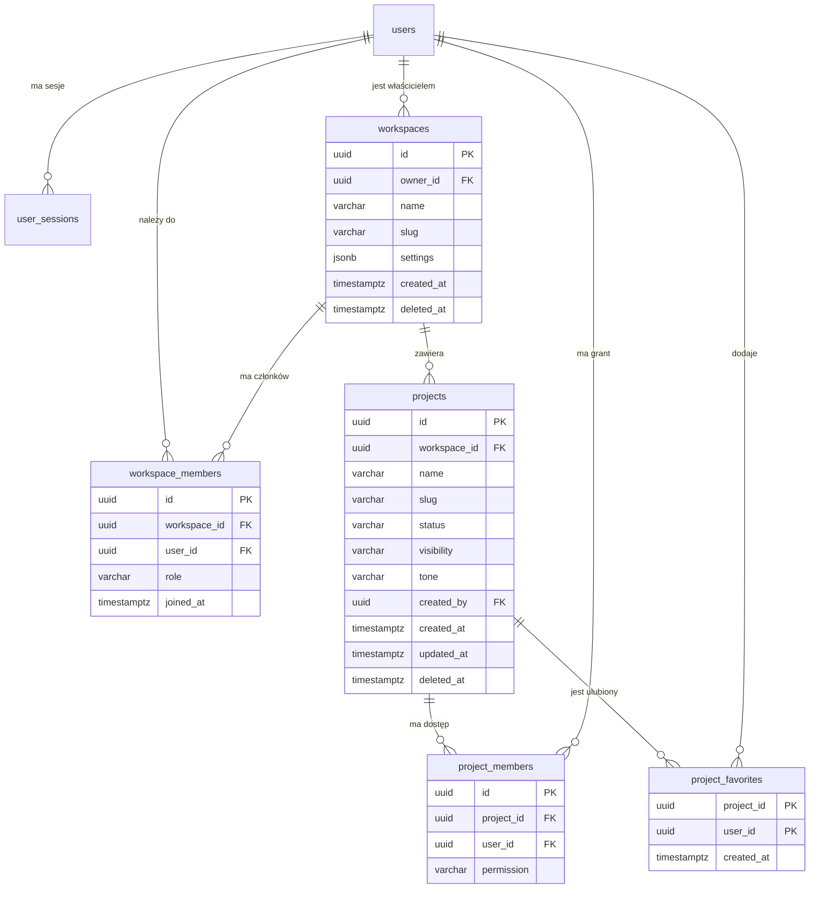
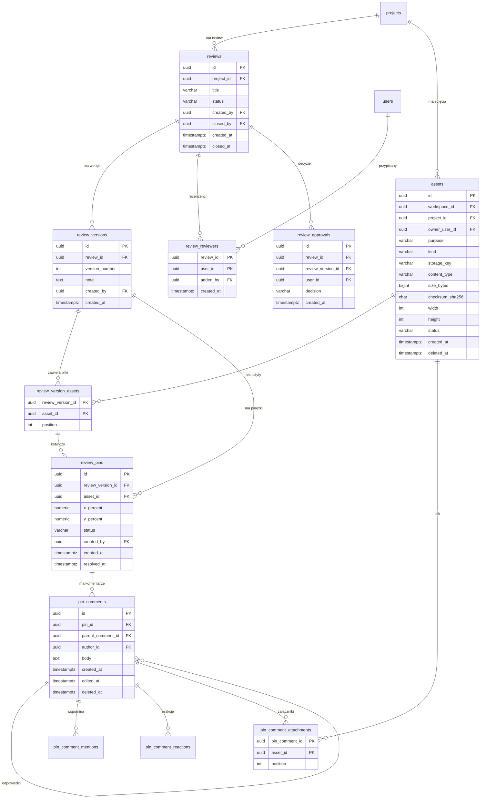
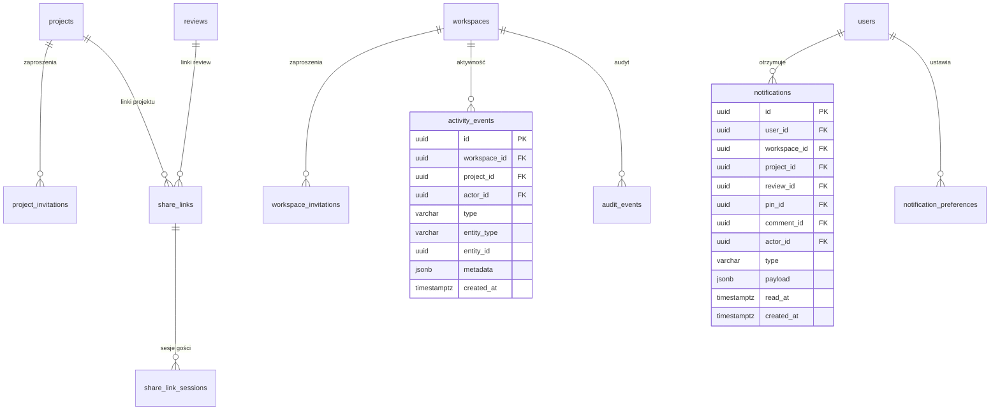

# MarkerIt — model bazy danych (propozycja)

> **Status: ZAAKCEPTOWANY I WDROŻONY.** Model jest wdrażany migracjami Flyway
> `V4`–`V11`. Tabele pod kolejne etapy powstają od razu; billing i integracje
> są poza zakresem.

## 1. Założenia

- Baza: PostgreSQL 17, migracje Flyway, dostęp przez Spring Data JPA.
- Klucze główne: `UUID` (generowane w aplikacji).
- Czasy: `TIMESTAMPTZ`, domyślnie `CURRENT_TIMESTAMP`; `updated_at` aktualizowany triggerem.
- Nazewnictwo: `snake_case`, tabele w liczbie mnogiej.
- Zamiast natywnych enumów PostgreSQL używamy `VARCHAR` + `CHECK`, żeby dodawanie
  wartości nie wymagało migracji typu.
- Soft delete (`deleted_at`) dla encji biznesowych: użytkownik, workspace, projekt,
  asset, pin, komentarz. Wątki recenzji (`reviews`) są usuwane twardo wraz z
  kaskadowymi powiązaniami. Twarde usuwanie pozostałych encji tylko przez zadania retencji.
- Tokeny (zaproszenia, linki share, API keys) przechowywane wyłącznie jako hash.
- Liczniki (liczba uwag, projektów itd.) **nie są** duplikowane w kolumnach —
  liczymy je zapytaniem/widokiem, dopóki wydajność nie wymusi tabeli agregatów.
- Każdy projekt należy do workspace'u. Workspace jest granicą tenanta i uprawnień.
- `users` już istnieje; model go rozszerza, nie zastępuje.

## 2. Diagram relacji — rdzeń

## 3. Diagram relacji — review, pinezki i komentarze

## 4. Diagram relacji — współpraca, powiadomienia, operacje

## 5. Tabela po tabeli

### 5.1. Rozszerzenie istniejących tabel

#### `users` (istnieje — rozszerzenie)

| Kolumna | Typ | Ograniczenia | Uwagi |
| --- | --- | --- | --- |
| `display_name` | `VARCHAR(80)` |  | Nazwa wyświetlana; dziś wyliczana z e-maila |
| `avatar_url` | `TEXT` |  | Docelowo może wskazywać asset |
| `locale` | `VARCHAR(10)` | `NOT NULL DEFAULT 'pl'` | `pl` / `en` |
| `last_seen_at` | `TIMESTAMPTZ` |  | Ostatnia aktywność |
| `deleted_at` | `TIMESTAMPTZ` |  | Soft delete konta |

Bez zmian pozostają: `id`, `email`, `password_hash`, `email_verified`, `created_at`, `updated_at`.

#### `user_sessions`, `email_verification_codes`

Bez zmian. Indeksy już istnieją.

### 5.2. Etap 1 — workspace i projekty (potrzebne dla obecnego dashboardu)

#### `workspaces`

| Kolumna | Typ | Ograniczenia |
| --- | --- | --- |
| `id` | `UUID` | PK |
| `owner_id` | `UUID` | `NOT NULL REFERENCES users(id) ON DELETE RESTRICT` |
| `name` | `VARCHAR(80)` | `NOT NULL`, `CHECK (length(btrim(name)) > 0)` |
| `slug` | `VARCHAR(80)` | `NOT NULL` |
| `description` | `TEXT` |  |
| `avatar_url` | `TEXT` |  |
| `settings` | `JSONB` | `NOT NULL DEFAULT '{}'` |
| `created_at` | `TIMESTAMPTZ` | `NOT NULL DEFAULT now()` |
| `updated_at` | `TIMESTAMPTZ` | `NOT NULL DEFAULT now()` |
| `deleted_at` | `TIMESTAMPTZ` |  |

- Unikalny `LOWER(slug)` wśród nieusuniętych.
- Indeks `owner_id`.

#### `workspace_members`

| Kolumna | Typ | Ograniczenia |
| --- | --- | --- |
| `id` | `UUID` | PK |
| `workspace_id` | `UUID` | `NOT NULL REFERENCES workspaces(id) ON DELETE CASCADE` |
| `user_id` | `UUID` | `NOT NULL REFERENCES users(id) ON DELETE CASCADE` |
| `role` | `VARCHAR(20)` | `CHECK (role IN ('OWNER','ADMIN','MEMBER','VIEWER'))` |
| `invited_by` | `UUID` | `REFERENCES users(id) ON DELETE SET NULL` |
| `joined_at` | `TIMESTAMPTZ` | `NOT NULL DEFAULT now()` |
| `created_at` | `TIMESTAMPTZ` | `NOT NULL DEFAULT now()` |

- `UNIQUE (workspace_id, user_id)`.
- Częściowy unikat: jeden `OWNER` na workspace.
- Indeks `user_id` (lista workspace'ów użytkownika).

#### `projects`

| Kolumna | Typ | Ograniczenia |
| --- | --- | --- |
| `id` | `UUID` | PK |
| `workspace_id` | `UUID` | `NOT NULL REFERENCES workspaces(id) ON DELETE CASCADE` |
| `name` | `VARCHAR(50)` | `NOT NULL`, `CHECK (length(btrim(name)) >= 3)` |
| `slug` | `VARCHAR(60)` | `NOT NULL` |
| `description` | `TEXT` |  |
| `status` | `VARCHAR(20)` | `NOT NULL DEFAULT 'ACTIVE'`, `CHECK (status IN ('ACTIVE','IN_REVIEW','CLOSED'))` |
| `visibility` | `VARCHAR(20)` | `NOT NULL DEFAULT 'WORKSPACE'`, `CHECK (visibility IN ('WORKSPACE','PRIVATE'))` |
| `tone` | `VARCHAR(20)` | `NOT NULL DEFAULT 'sage'`, `CHECK (tone IN ('sage','sand','blue','lilac','emerald','amber'))` |
| `created_by` | `UUID` | `REFERENCES users(id) ON DELETE SET NULL` |
| `created_at` | `TIMESTAMPTZ` | `NOT NULL DEFAULT now()` |
| `updated_at` | `TIMESTAMPTZ` | `NOT NULL DEFAULT now()` |
| `archived_at` | `TIMESTAMPTZ` |  |
| `deleted_at` | `TIMESTAMPTZ` |  |

- `UNIQUE (workspace_id, slug)` wśród nieusuniętych.
- Indeksy: `(workspace_id, status)`, `(workspace_id, updated_at DESC)`.
- Mapowanie obecnego UI: `W toku` → `ACTIVE`, `Do sprawdzenia` → `IN_REVIEW`,
  `Zamknięty` → `CLOSED`. **Zamknięty = zarchiwizowany** — nie ma osobnego statusu
  `ARCHIVED`; filtr „Archiwum” pokazuje projekty `CLOSED`.
- `isShared` nie jest kolumną — wynika z `project_members` / `share_links`.

#### `project_members`

| Kolumna | Typ | Ograniczenia |
| --- | --- | --- |
| `id` | `UUID` | PK |
| `project_id` | `UUID` | `NOT NULL REFERENCES projects(id) ON DELETE CASCADE` |
| `user_id` | `UUID` | `NOT NULL REFERENCES users(id) ON DELETE CASCADE` |
| `permission` | `VARCHAR(20)` | `CHECK (permission IN ('VIEW','COMMENT','EDIT','ADMIN'))` |
| `added_by` | `UUID` | `REFERENCES users(id) ON DELETE SET NULL` |
| `created_at` | `TIMESTAMPTZ` | `NOT NULL DEFAULT now()` |

- `UNIQUE (project_id, user_id)`, indeks `user_id`.
- Członkowie workspace'u widzą projekty `WORKSPACE`; `PRIVATE` tylko osoby z grantem.
- Zewnętrzni współpracownicy dostają grant tutaj, bez członkostwa w workspace.

#### `project_favorites` (etap 1, opcjonalne)

- `project_id`, `user_id`, `created_at`; PK `(project_id, user_id)`.

### 5.3. Etap 2 — pliki, review, pinezki, komentarze

#### `assets`

| Kolumna | Typ | Ograniczenia |
| --- | --- | --- |
| `id` | `UUID` | PK |
| `workspace_id` | `UUID` | `REFERENCES workspaces(id) ON DELETE CASCADE` (null dla awatara) |
| `project_id` | `UUID` | `REFERENCES projects(id) ON DELETE CASCADE` (wymagane dla `REVIEW_IMAGE`) |
| `owner_user_id` | `UUID` | `REFERENCES users(id) ON DELETE CASCADE` (wymagane dla `AVATAR`; dla plików projektu właściciel uploadu) |
| `purpose` | `VARCHAR(20)` | `NOT NULL`, `CHECK (purpose IN ('REVIEW_IMAGE','AVATAR','ATTACHMENT'))` |
| `kind` | `VARCHAR(20)` | `CHECK (kind IN ('IMAGE','PDF','VIDEO','OTHER'))` |
| `storage_provider` | `VARCHAR(20)` | `NOT NULL DEFAULT 'R2'`, `CHECK (storage_provider IN ('R2','S3','LOCAL'))` |
| `storage_key` | `TEXT` | `NOT NULL` |
| `original_name` | `TEXT` | `NOT NULL` |
| `content_type` | `VARCHAR(255)` | `NOT NULL` |
| `size_bytes` | `BIGINT` | `NOT NULL CHECK (size_bytes >= 0)` |
| `checksum_sha256` | `CHAR(64)` |  |
| `width` | `INTEGER` | `CHECK (width IS NULL OR width > 0)` |
| `height` | `INTEGER` | `CHECK (height IS NULL OR height > 0)` |
| `status` | `VARCHAR(20)` | `NOT NULL DEFAULT 'PENDING'`, `CHECK (status IN ('PENDING','READY','FAILED'))` |
| `metadata` | `JSONB` | `NOT NULL DEFAULT '{}'` |
| `created_at` | `TIMESTAMPTZ` | `NOT NULL DEFAULT now()` |
| `deleted_at` | `TIMESTAMPTZ` |  |

- `UNIQUE (storage_provider, storage_key)`.
- Indeks `(workspace_id, created_at DESC) WHERE deleted_at IS NULL` oraz częściowy
  `(project_id, created_at DESC) WHERE purpose = 'REVIEW_IMAGE' AND deleted_at IS NULL`.
- Trigger `assets_enforce_project_limit`: maks. **8 zdjęć `REVIEW_IMAGE` na projekt**
  (aktywne, nieusunięte). To limit zużycia R2, nie bazy.
- Trigger sprawdza też, że `project_id` należy do tego samego workspace co asset.

#### `asset_variants` (miniatury/preview — etap 2+)

- `id`, `asset_id`, `variant` (`thumb`, `preview`, `original`), `storage_key`,
  `width`, `height`, `size_bytes`, `created_at`.
- `UNIQUE (asset_id, variant)`.

#### `reviews`

Review = kontener na jedną rzecz do oceny (np. makieta, plakat, ekran) wraz z wersjami.

| Kolumna | Typ | Ograniczenia |
| --- | --- | --- |
| `id` | `UUID` | PK |
| `project_id` | `UUID` | `NOT NULL REFERENCES projects(id) ON DELETE CASCADE` |
| `title` | `VARCHAR(120)` | `NOT NULL` |
| `description` | `TEXT` |  |
| `status` | `VARCHAR(20)` | `NOT NULL DEFAULT 'OPEN'`, `CHECK (status IN ('OPEN','CLOSED'))` |
| `created_by` | `UUID` | `REFERENCES users(id) ON DELETE SET NULL` |
| `created_at` | `TIMESTAMPTZ` | `NOT NULL DEFAULT now()` |
| `updated_at` | `TIMESTAMPTZ` | `NOT NULL DEFAULT now()` |
| `closed_by` | `UUID` | `REFERENCES users(id) ON DELETE SET NULL` (dodane w `V9`) |
| `closed_at` | `TIMESTAMPTZ` |  |
| `deleted_at` | `TIMESTAMPTZ` | kolumna historyczna; wątki recenzji są usuwane twardo |

- Indeksy: `(project_id, status)`, `(project_id, updated_at DESC)`.
- Usunięcie wątku jest twarde: kaskadowo znikają wersje, pinezki, komentarze,
  decyzje i przypisania recenzentów.

#### `review_reviewers`

Przypisani recenzenci wątku (dodane w `V9`).

| Kolumna | Typ | Ograniczenia |
| --- | --- | --- |
| `review_id` | `UUID` | `NOT NULL REFERENCES reviews(id) ON DELETE CASCADE` |
| `user_id` | `UUID` | `NOT NULL REFERENCES users(id) ON DELETE CASCADE` |
| `added_by` | `UUID` | `REFERENCES users(id) ON DELETE SET NULL` |
| `created_at` | `TIMESTAMPTZ` | `NOT NULL DEFAULT now()` |

- PK `(review_id, user_id)`, indeks `user_id`.
- Zmiana przypisania jest nową generacją: decyzje sprzed `created_at`
  bieżącego przypisania nie liczą się do zamknięcia wątku.

#### `review_versions`

| Kolumna | Typ | Ograniczenia |
| --- | --- | --- |
| `id` | `UUID` | PK |
| `review_id` | `UUID` | `NOT NULL REFERENCES reviews(id) ON DELETE CASCADE` |
| `version_number` | `INTEGER` | `NOT NULL CHECK (version_number > 0)` |
| `note` | `TEXT` |  |
| `created_by` | `UUID` | `REFERENCES users(id) ON DELETE SET NULL` |
| `created_at` | `TIMESTAMPTZ` | `NOT NULL DEFAULT now()` |

- `UNIQUE (review_id, version_number)`.

#### `review_version_assets`

| Kolumna | Typ | Ograniczenia |
| --- | --- | --- |
| `review_version_id` | `UUID` | `NOT NULL REFERENCES review_versions(id) ON DELETE CASCADE` |
| `asset_id` | `UUID` | `NOT NULL REFERENCES assets(id) ON DELETE RESTRICT` |
| `position` | `INTEGER` | `NOT NULL DEFAULT 0 CHECK (position >= 0)` |

- PK `(review_version_id, asset_id)`.
- `UNIQUE (review_version_id, position)`.
- Trigger `review_version_assets_project_check` pilnuje, że asset i review należą do tego samego projektu oraz że asset ma `purpose = 'REVIEW_IMAGE'`.

#### `review_pins`

| Kolumna | Typ | Ograniczenia |
| --- | --- | --- |
| `id` | `UUID` | PK |
| `review_version_id` | `UUID` | `NOT NULL` |
| `asset_id` | `UUID` | `NOT NULL` |
| `x_percent` | `NUMERIC(6,3)` | `NOT NULL CHECK (x_percent BETWEEN 0 AND 100)` |
| `y_percent` | `NUMERIC(6,3)` | `NOT NULL CHECK (y_percent BETWEEN 0 AND 100)` |
| `status` | `VARCHAR(20)` | `NOT NULL DEFAULT 'OPEN'`, `CHECK (status IN ('OPEN','RESOLVED'))` |
| `created_by` | `UUID` | `REFERENCES users(id) ON DELETE SET NULL` |
| `created_at` | `TIMESTAMPTZ` | `NOT NULL DEFAULT now()` |
| `resolved_by` | `UUID` | `REFERENCES users(id) ON DELETE SET NULL` |
| `resolved_at` | `TIMESTAMPTZ` |  |
| `deleted_at` | `TIMESTAMPTZ` |  |

- FK złożony `(review_version_id, asset_id) → review_version_assets`.
- Indeks `(review_version_id, status)`.
- Współrzędne w procentach — niezależne od rozdzielczości.

#### `pin_comments`

| Kolumna | Typ | Ograniczenia |
| --- | --- | --- |
| `id` | `UUID` | PK |
| `pin_id` | `UUID` | `NOT NULL REFERENCES review_pins(id) ON DELETE CASCADE` |
| `parent_comment_id` | `UUID` | `REFERENCES pin_comments(id) ON DELETE CASCADE` |
| `author_id` | `UUID` | `REFERENCES users(id) ON DELETE SET NULL` |
| `body` | `TEXT` | `NOT NULL CHECK (length(btrim(body)) > 0)` |
| `created_at` | `TIMESTAMPTZ` | `NOT NULL DEFAULT now()` |
| `updated_at` | `TIMESTAMPTZ` | `NOT NULL DEFAULT now()` |
| `edited_at` | `TIMESTAMPTZ` |  |
| `deleted_at` | `TIMESTAMPTZ` |  |

- Indeks `(pin_id, created_at)`.
- Pierwszy komentarz pinu tworzony w tej samej transakcji co pin (obecny walidator
  `pinCreateSchema` zawiera `body`).
- Wątki przez `parent_comment_id`; głębokość ograniczana w serwisie.

#### `pin_comment_attachments` (dodane w `V11`)

| Kolumna | Typ | Ograniczenia |
| --- | --- | --- |
| `pin_comment_id` | `UUID` | `NOT NULL REFERENCES pin_comments(id) ON DELETE CASCADE` |
| `asset_id` | `UUID` | `NOT NULL REFERENCES assets(id) ON DELETE RESTRICT` |
| `position` | `INTEGER` | `NOT NULL DEFAULT 0 CHECK (position >= 0)` |

- PK `(pin_comment_id, asset_id)`, `UNIQUE (pin_comment_id, position)`,
  indeks `asset_id`.
- Dołączać można wyłącznie assety `purpose = 'ATTACHMENT'` z tego samego
  projektu; załączniki nie zajmują limitu zdjęć do recenzji.
- `V11` dodaje też indeks `review_pins (review_version_id, created_at)` dla
  aktywnych pinezek.

#### `pin_comment_mentions`, `pin_comment_reactions`

- `pin_comment_mentions (pin_comment_id, mentioned_user_id)` — PK złożony.
- `pin_comment_reactions (pin_comment_id, user_id, emoji)` — PK złożony,
  `emoji VARCHAR(32)`, `created_at`.

#### `review_approvals` (etap 2+)

- `id`, `review_id`, `review_version_id`, `user_id`, `decision`
  (`APPROVED` / `CHANGES_REQUESTED`), `note`, `created_at`.
- `review_version_id` (`UUID`, `NOT NULL REFERENCES review_versions(id) ON DELETE CASCADE`)
  dodane w `V10`; migracja uzupełnia istniejące decyzje najnowszą wersją wątku
  i usuwa wiersze bez wersji.
- Decyzja dotyczy konkretnej wersji. Nowa wersja wymaga ponownych decyzji
  aktualnie przypisanych recenzentów.
- Indeks `(review_id, user_id, review_version_id, created_at DESC)`.
- Historia decyzji (bez unikatu); aktualna = najnowsza dla najnowszej wersji,
  utworzona po dodaniu bieżącego przypisania recenzenta.

#### `tags`, `project_tags` (etap 2+, opcjonalne)

- `tags`: `id`, `workspace_id`, `name`, `color`, `created_at`;
  `UNIQUE (workspace_id, LOWER(name))`.
- `project_tags`: PK `(project_id, tag_id)`.

### 5.4. Etap 3 — zaproszenia i udostępnianie

#### `workspace_invitations`

| Kolumna | Typ | Ograniczenia |
| --- | --- | --- |
| `id` | `UUID` | PK |
| `workspace_id` | `UUID` | `NOT NULL REFERENCES workspaces(id) ON DELETE CASCADE` |
| `email` | `VARCHAR(320)` | `NOT NULL`, znormalizowany lowercase |
| `role` | `VARCHAR(20)` | `CHECK (role IN ('ADMIN','MEMBER','VIEWER'))` |
| `token_hash` | `CHAR(64)` | `NOT NULL UNIQUE` |
| `invited_by` | `UUID` | `REFERENCES users(id) ON DELETE SET NULL` |
| `expires_at` | `TIMESTAMPTZ` | `NOT NULL` |
| `accepted_at` | `TIMESTAMPTZ` |  |
| `revoked_at` | `TIMESTAMPTZ` |  |
| `created_at` | `TIMESTAMPTZ` | `NOT NULL DEFAULT now()` |

- Częściowy unikat `(workspace_id, LOWER(email))` dla pending.

#### `project_invitations`

Analogicznie do `workspace_invitations`, z `project_id` i `permission`
(`VIEW`, `COMMENT`, `EDIT`, `ADMIN`).

#### `share_links`

Publiczne/wewnętrzne linki do review lub całego projektu.

| Kolumna | Typ | Ograniczenia |
| --- | --- | --- |
| `id` | `UUID` | PK |
| `workspace_id` | `UUID` | `NOT NULL REFERENCES workspaces(id) ON DELETE CASCADE` |
| `project_id` | `UUID` | `REFERENCES projects(id) ON DELETE CASCADE` |
| `review_id` | `UUID` | `REFERENCES reviews(id) ON DELETE CASCADE` |
| `token_hash` | `CHAR(64)` | `NOT NULL UNIQUE` |
| `permission` | `VARCHAR(20)` | `CHECK (permission IN ('VIEW','COMMENT'))` |
| `password_hash` | `VARCHAR(255)` |  |
| `expires_at` | `TIMESTAMPTZ` |  |
| `max_uses` | `INTEGER` | `CHECK (max_uses IS NULL OR max_uses > 0)` |
| `use_count` | `INTEGER` | `NOT NULL DEFAULT 0 CHECK (use_count >= 0)` |
| `created_by` | `UUID` | `REFERENCES users(id) ON DELETE SET NULL` |
| `revoked_at` | `TIMESTAMPTZ` |  |
| `created_at` | `TIMESTAMPTZ` | `NOT NULL DEFAULT now()` |

- `CHECK (num_nonnulls(project_id, review_id) = 1)` — link wskazuje dokładnie jeden zasób.
- Indeksy po `project_id`, `review_id`.

#### `share_link_sessions`

- `id`, `share_link_id`, `guest_name`, `guest_email`, `session_token_hash UNIQUE`,
  `expires_at`, `created_at`, `last_seen_at`.
- Tożsamość gościa dla komentarzy bez konta.

### 5.5. Etap 4 — powiadomienia, aktywność, audyt, kolejka e-mail

#### `notifications`

- `id`, `user_id`, `workspace_id`, `project_id`, `review_id`, `pin_id`, `comment_id`,
  `actor_id`, `type`, `payload JSONB`, `read_at`, `created_at`.
- Indeksy: `(user_id, read_at)`, `(user_id, created_at DESC)`.
- `type` np. `COMMENT_ADDED`, `MENTION`, `PIN_RESOLVED`, `INVITATION_ACCEPTED`.

#### `notification_preferences`

- PK `(user_id, type, channel)`; `channel` (`IN_APP`, `EMAIL`), `enabled`, `updated_at`.

#### `email_outbox`

- `id`, `to_email`, `template`, `payload JSONB`, `status`
  (`PENDING`/`SENDING`/`SENT`/`FAILED`), `attempts`, `last_error`,
  `next_attempt_at`, `sent_at`, `created_at`.
- Indeks `(status, next_attempt_at)`.
- Zastępuje wysyłkę „w locie” i daje retry.

#### `activity_events`

- `id`, `workspace_id`, `project_id`, `actor_id`, `type`, `entity_type`,
  `entity_id`, `metadata JSONB`, `created_at`.
- Indeksy: `(workspace_id, created_at DESC)`, `(project_id, created_at DESC)`.
- Zasila feed „ostatnia aktywność”.

#### `audit_events`

- `id`, `workspace_id`, `actor_id`, `action`, `target_type`, `target_id`,
  `ip_address INET`, `user_agent TEXT`, `metadata JSONB`, `created_at`.
- Indeksy: `(workspace_id, created_at DESC)`, `(actor_id, created_at DESC)`.
- Akcje bezpieczeństwa: logowanie, zmiana uprawnień, usunięcie projektu itp.

## 6. Uprawnienia — proponowany model

### Role workspace

| Rola | Uprawnienia |
| --- | --- |
| `OWNER` | wszystko, transfer własności, usunięcie workspace |
| `ADMIN` | zarządzanie członkami, projektami, ustawieniami |
| `MEMBER` | tworzenie/edycja projektów, wątków i wersji, recenzowanie, komentarze |
| `VIEWER` | podgląd, pinezki, komentarze i załączniki w otwartych wątkach; bez edycji wątków, obrazów i decyzji |

W obecnym wdrożeniu review korzysta z ról workspace. Granty projektowe
(`VIEW`/`COMMENT`/`EDIT`/`ADMIN`) istnieją w schemacie, ale nie sterują jeszcze
widocznością ani akcjami w UI.

### Uprawnienia projektowe

| Poziom | Znaczenie |
| --- | --- |
| `VIEW` | podgląd projektu i review |
| `COMMENT` | + dodawanie pinezek i komentarzy |
| `EDIT` | + edycja projektu, wersji, statusów |
| `ADMIN` | + zarządzanie członkami i usuwanie |

**Zasada:** efektywne uprawnienie = maksimum z roli workspace i grantu projektowego.
Członek workspace'u widzi projekty `WORKSPACE`; projekt `PRIVATE` wymaga grantu.
`OWNER`/`ADMIN` workspace'u mają `ADMIN` we wszystkich projektach.

## 7. Ważne decyzje projektowe

1. **Workspace jako tenant** — każdy projekt ma `workspace_id`; nie ma projektów
   „poza workspace”. Domyślny osobisty workspace tworzony automatycznie przy pierwszym wejściu.
2. **Wersjonowanie review** — review ma wersje, a pinezki są przypięte do wersji
   i konkretnego assetu. Pozwala to zachować historię uwag po podmianie grafiki.
3. **Pineczki w procentach** — `x_percent`/`y_percent` (0–100) zamiast pikseli,
   dzięki czemu działają przy każdej rozdzielczości.
4. **Komentarze jako drzewo** — `parent_comment_id`; pierwszy komentarz pinu
   powstaje razem z pinem.
5. **Brak duplikowanych liczników** — `project.count` i `Project.updated` w UI
   liczone z `pin_comments` i `updated_at`. Ewentualne materialized views później.
6. **Soft delete + retencja** — usunięcie projektu chowa go z UI; fizyczne czyszczenie
   i pliki robi zadanie cykliczne.
7. **Tokeny tylko jako hash** — zaproszenia, linki share, API keys.
8. **Rozszerzalność** — `settings`, `metadata`, `payload` jako `JSONB` tam, gdzie
   struktura może się zmieniać; reszta w kolumnach z `CHECK`.
9. **Pliki w magazynie S3/R2** — baza przechowuje tylko metadane, `storage_provider` i `storage_key`.
10. **Twarde limity** — 3 przestrzenie, 3 projekty w przestrzeni, 8 zdjęć
    `REVIEW_IMAGE` na projekt; egzekwowane w serwisie i triggerami PostgreSQL.
    Liczba review, wersji, pinezek, komentarzy i załączników komentarzy jest
    nieograniczona — limit dotyczy wyłącznie obrazów do recenzji w magazynie S3.

## 8. Wdrożone migracje

Wszystkie tabele powstają od razu (wariant „od razu”):

| Migracja | Zakres |
| --- | --- |
| `V4__core_workspaces_projects.sql` | rozszerzenie `users`, `workspaces`, `workspace_members`, `projects`, `project_members`, `project_favorites`, `assets`, `asset_variants`, triggery limitów |
| `V5__reviews_assets_pins.sql` | `reviews`, `review_versions`, `review_version_assets`, `review_pins`, `pin_comments`, mentions, reactions, approvals, `tags`, `project_tags` |
| `V6__collaboration_notifications.sql` | `workspace_invitations`, `project_invitations`, `share_links`, `share_link_sessions`, `notifications`, `notification_preferences`, `email_outbox`, `activity_events`, `audit_events` |
| `V7__review_image_storage_limit.sql` | `assets.project_id`, limit 8 zdjęć na projekt, walidacja przynależności assetu do projektu |
| `V8__allow_s3_storage_provider.sql` | `storage_provider` dopuszcza `S3` (MinIO i inne magazyny zgodne z S3) obok `R2` i `LOCAL` |
| `V9__review_thread_reviewers.sql` | `review_reviewers`, `reviews.closed_by` |
| `V10__review_approvals_version.sql` | `review_approvals.review_version_id`, backfill do najnowszej wersji i indeks wersjonowanych decyzji |
| `V11__pin_comments_attachments.sql` | `pin_comment_attachments`, indeks aktywnych pinezek wersji |

Billing i integracje (API keys, webhooks) są świadomie pominięte.

## 9. Limity produktu

Limity są egzekwowane w serwisach oraz triggerami w bazie:

| Zasób | Limit | Egzekwowanie |
| --- | --- | --- |
| Przestrzenie robocze na użytkownika | 3 | `WorkspaceService` + trigger `workspaces_enforce_limit` |
| Projekty w przestrzeni | 3 | `ProjectService` + trigger `projects_enforce_limit` |
| Zdjęcia do review (`REVIEW_IMAGE`) w projekcie | 8 | trigger `assets_enforce_project_limit` + walidacja w serwisie uploadu |
| Załączniki komentarzy (`ATTACHMENT`) w projekcie | bez limitu | nie zajmują limitu zdjęć; maks. 10 na komentarz |
| Review, wersje, pinezki, komentarze | bez limitu | — (limit dotyczy tylko obrazów do recenzji w magazynie) |

## 10. Przechowywanie plików

- Pliki binarne: magazyn zgodny z S3, nie w bazie. Development używa lokalnego
  **MinIO** (`STORAGE_PROVIDER=S3`), produkcja **Cloudflare R2**
  (`STORAGE_PROVIDER=R2`) albo inny magazyn S3.
- W bazie trzymamy metadane i klucz obiektu w `assets` (`storage_provider`,
  `storage_key`, `content_type`, `original_name`, `size_bytes`, `checksum_sha256`,
  `width`, `height`). `storage_provider` przyjmuje `R2`, `S3` lub `LOCAL`
  (migracja `V8`).
- Odczyty i usuwanie plików wybierają backend na podstawie providera zapisanego
  na assecie. W danej konfiguracji istnieje jednak tylko backend wskazany przez
  `STORAGE_PROVIDER`, więc zmiana providera bez migracji obiektów sprawia, że
  starsze pliki stają się nieczytelne (brak automatycznej migracji).
- Zdjęcia profilowe: schemat rezerwuje `assets.purpose = 'AVATAR'` i
  `users.avatar_asset_id`, ale upload awatarów nie jest jeszcze zaimplementowany.
- Zdjęcia do review: `assets.purpose = 'REVIEW_IMAGE'`, podpięte przez
  `review_version_assets`.
- Miniatury/preview: `asset_variants`.
- Dla developmentu/testów dopuszczamy `storage_provider = 'LOCAL'` (katalog
  `LOCAL_STORAGE_DIR`).
- Pliki są serwowane przez uwierzytelniony endpoint
  `GET /api/v1/assets/{id}/content`. `AssetResponse.url` jest ścieżką względną do
  bazowego adresu API (`assets/{id}/content`), więc klient, który już dodaje
  prefiks `/api/v1`, nie powinien go doklejać ponownie. Obiekty są niezmienne,
  dlatego odpowiedź zawiera `Cache-Control: private, max-age=31536000, immutable`
  oraz `ETag` wyliczony z `checksum_sha256` (lub `id`, gdy checksum jest pusty).

## 11. Decyzje przyjęte

1. Workspace jest tenantem; domyślny osobisty workspace tworzony automatycznie. ✅
2. Role: `OWNER`, `ADMIN`, `MEMBER`, `VIEWER` + granty projektowe
   `VIEW`, `COMMENT`, `EDIT`, `ADMIN`. ✅
3. Review z wersjami. ✅
4. Pinezki przypięte do wersji i assetu. ✅
5. Wszystkie tabele od razu. ✅
6. Bez billingu. ✅
7. Bez importu danych z `localStorage` — startujemy od nowa. ✅
8. `display_name` i `avatar_asset_id` w `users`; awatary są zarezerwowane
   w schemacie, ale ich upload nie jest jeszcze wdrożony. Pliki review trafiają
   do magazynu S3/R2. ✅
